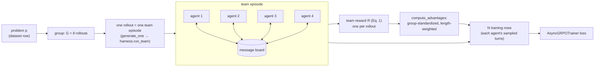

# s3 information aggregation with AsyncGRPO

A small replication of the information-aggregation experiment from
[s3 (arXiv 2611.08615)](https://huggingface.co/papers/2611.08615): a team of N = 4 Qwen3-0.6B agents (thinking on) trained
with a shared team reward to talk to each other.

Each agent holds one private number between 1 and 99, written in English words. The team must return all four
numbers in ascending order, keeping duplicates. It succeeds if any agent's final list is correct. Nobody can solve it
alone, so the only way to score is to message the number and read teammates' messages.

## What is in this folder

| File | What it does |
| --- | --- |
| [`harness/task.py`](harness/task.py) | The task: problems, the paper's prompts (App. G) and tools (`message`, `read_messages`, `check_notifications`), answer parsing, team reward (Eq. 1). |
| [`harness/team.py`](harness/team.py) | One team episode: N asynchronous agents generating on token ids, each with its tools (`AgentTools`) on an in-memory message board, notifications at request boundaries, idling and wake-ups, and the final-answer request (§3.1, App. F). |
| [`async_grpo_s3_aggregation.py`](async_grpo_s3_aggregation.py) | Training with `AsyncGRPOTrainer`: a custom `AsyncRolloutLoop` whose rollout is a whole team episode. The module docstring maps the paper's objective onto the config. |
| [`evaluate.py`](evaluate.py) | Evaluates a served model on held-out problems; one JSON line per team episode. |

The harness works on token ids, so the training rows are exactly the sampled tokens and the sampler's logprobs.
Prompts are rendered with the tokenizer's chat template; each new message (a tool result, a notification, the final
request) is appended as the template renders it after the assistant turn, and earlier turns are never re-rendered.
In training, agents sample through the rollout loop's `generate_one_turn` and use its tokenizer and chat template;
`evaluate.py` samples from a served model with `VLLMSampler` instead.

## How it maps onto AsyncGRPO



Every agent samples from the same policy through the loop's `generate_one_turn`; the team's reward and advantage
are shared by all its agents' rows.

- **One rollout = one team.** `generate_one` runs `harness.run_team` and returns each agent's sampled stretches as
  `TurnRecord`s. Each request is one `generate_one_turn` call of at most `max_completion_length` = 1,024 tokens, the
  paper's chunk between notifications. Each agent's turns chain into one training row, so a team gives N rows that share the team's
  advantage.
- **Groups are G = 8 teams on the same problem.** The numbers are the same across the group; the agent names and
  teammate orders differ.
- **Loss (Eq. 3).** PPO clipping is off (`epsilon=1`, `epsilon_high=1e9`). Tokens are masked by the importance ratio
  (`vllm_importance_sampling_clip_min/max = 0.2/5.0`). `compute_advantages` divides each team's advantage by its trained
  tokens |T_g|, and `TeamTrainer` scales out TRL's per-micro-batch token mean and divides the update's gradient by its
  team count |B| (rows / N, since every team gives one row per agent) before clipping. So every team counts equally
  however the batcher packs or splits teams, as in the paper's mean over teams of per-team token means.
  Micro-batches use TRL's token-budget packing, and `gradient_accumulation_steps` is `--teams-per-update` / 2,
  for about two teams per 40,960-token micro-batch. So `--teams-per-update` is approximate: a team forwards about
  17k tokens, so a micro-batch holds about 2.4 teams and an update about 150, varying with team length.
- **Concurrency.** Rollouts start at TRL's default cap (KV cache tokens / max model length, about 14 teams) and
  the control loop raises it while the vLLM KV cache has room, up to `--concurrent-teams`.

Not implemented: the KL penalty the paper lists for this task (its coefficient and reference model are not
published), and the individual-reward and online-SFT baselines.

## Setup

Use this TRL checkout with vLLM installed:

```sh
pip install -e ".[vllm,kernels]" datasets httpx
```

## Training

On two GPUs, run vLLM on one and the trainer on the other, from the repository root:

```sh
CUDA_VISIBLE_DEVICES=0 VLLM_SERVER_DEV_MODE=1 vllm serve Qwen/Qwen3-0.6B --port 8000 \
    --max-model-len 40960 --max-num-seqs 512 --enable-prefix-caching \
    --logprobs-mode processed_logprobs --weight-transfer-config '{"backend":"nccl"}'

CUDA_VISIBLE_DEVICES=1 accelerate launch --num_processes 1 --mixed_precision bf16 \
    examples/async_grpo_s3_aggregation/async_grpo_s3_aggregation.py \
    --vllm-url http://127.0.0.1:8000 --teams-per-update 128 --updates 50 --concurrent-teams 128
```

This is the run reported below. Training uses problem ids 0 to 1023, G = 8, a constant learning rate of 5e-7,
`max_staleness=4`, and a checkpoint every 10 updates. The trainer logs per-episode team metrics: `team/success`, `team/reward`,
`team/tokens`, `team/messages`, `team/broadcasts`, `team/reads`, `team/notifications`, `team/bad_recipients`,
`team/silent_agent_frac` (agents that never messaged), `team/correct_agent_frac`, and how agents ended their work
phase (`team/work_end_{answered,idle,allowance,context}_frac`). The paper trains for 200 updates; `--updates 200` continues the same recipe.

## Evaluation

Serve the base model or a checkpoint (no weight-transfer flags needed), then evaluate on 192 held-out problems:

```sh
vllm serve Qwen3-0.6B-S3-Aggregation/checkpoint-50 --port 8000 \
    --max-model-len 40960 --max-num-seqs 512 --enable-prefix-caching

python examples/async_grpo_s3_aggregation/evaluate.py --url http://127.0.0.1:8000 \
    --model Qwen3-0.6B-S3-Aggregation/checkpoint-50 --name ckpt50 --episodes 192
```

Held-out problems use ids 1,000,000 and up, and the team seed is the episode index, so reruns score the same
teams. Add `--save-tokens` to keep each agent's full token context.

## Results

50 updates of 128 teams on 2 H100s took about 2.9 hours.


Training success (teams solved, mean over 5-update blocks):

| updates | 1-5 | 6-10 | 11-15 | 16-20 | 21-25 | 26-30 | 31-35 | 36-40 | 41-45 | 46-50 |
| --- | --- | --- | --- | --- | --- | --- | --- | --- | --- | --- |
| success | 5.6% | 7.2% | 7.0% | 8.6% | 12.8% | 15.5% | 21.2% | 25.9% | 36.4% | 34.9% |

Messages per team rose from 3.6 to 4.9. Tokens per team stayed at about 13.3k out of a 36.9k team allowance. The
mean importance ratio stayed at about 0.996.

Held-out evaluation (192 problems, 64 teams in flight):

| model | success | messages / team | tokens / team | most common failure |
| --- | --- | --- | --- | --- |
| Qwen3-0.6B | 9.4% (SE 2.1) | 3.90 | 13.4k | an agent never messaged (81% of failures) |
| checkpoint-50 | **49.5%** (SE 3.6) | 5.51 | 13.1k | an agent never messaged (68% of failures) |

A second base run with 8 teams in flight gave 6.8% (SE 1.8). For comparison, the paper reports 1.6% for the base
model and 93.2% after 200 updates. Our base is higher, probably because parts of the paper's system prompt are
unpublished and left out here (marked in `harness/task.py`). At 50 updates the curve is still rising.

The training curves above come from an earlier version of this code with the same prompts, tools, reward and
trainer settings, except that it sampled from the vLLM server directly instead of through `generate_one_turn`, put
one team in each micro-batch (128 per update) instead of weighting rows by team, and started at 128 teams in
flight. The checkpoint was then evaluated with the harness in this folder.

## Deviations from the paper

- Elided parts of the paper's prompts are left out. The identity line ("Your name is ...") and the example tool
  calls are written by us.
- An agent whose own token allowance runs out is asked for its final answer right away, not when the whole team's
  work phase ends. It cannot read messages in between, so its context at the request is the same.
- No KL penalty.
- Groups whose teams all get the same reward are dropped (TRL's default) and replaced by new ones; the paper keeps
  them with advantage 0 (App. C).
